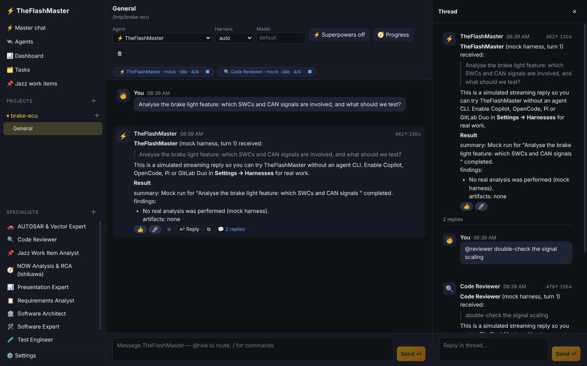
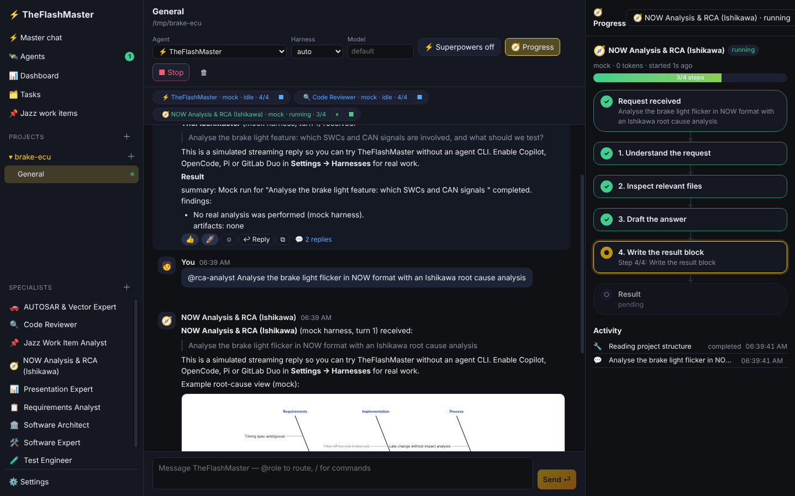
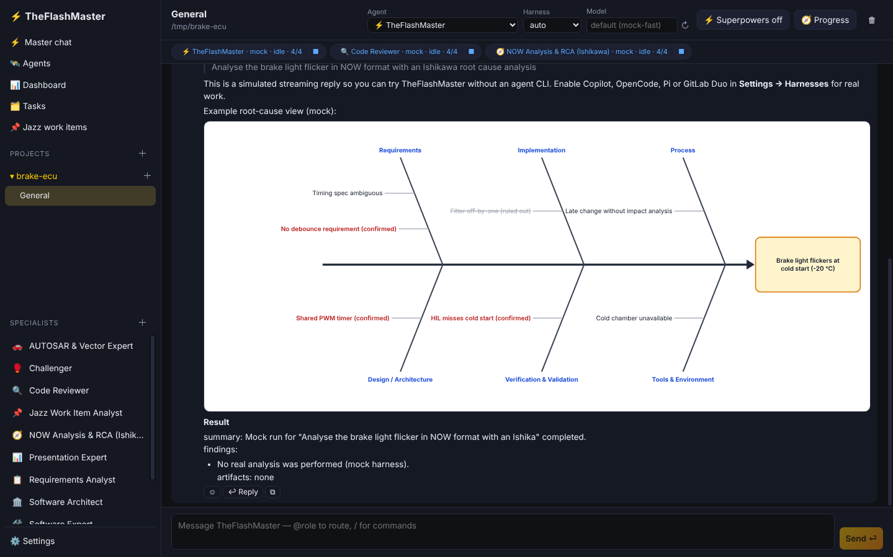
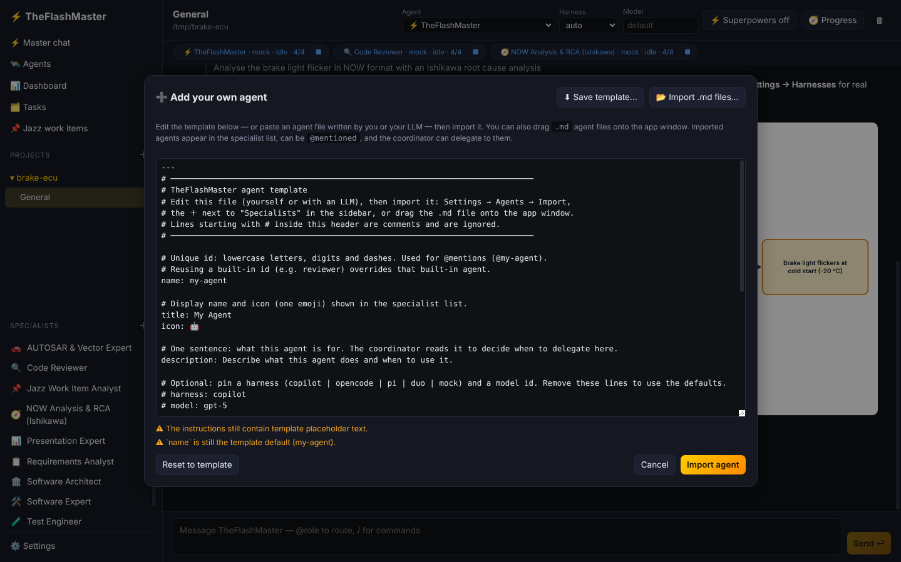
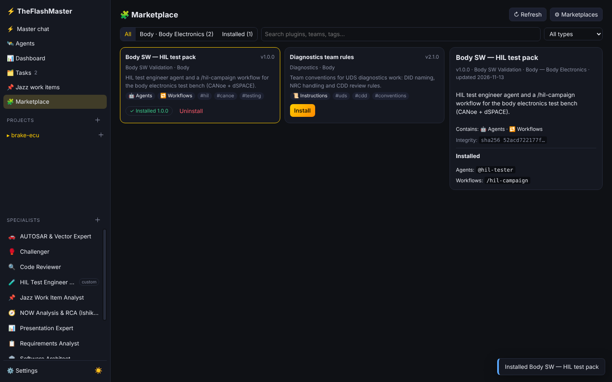
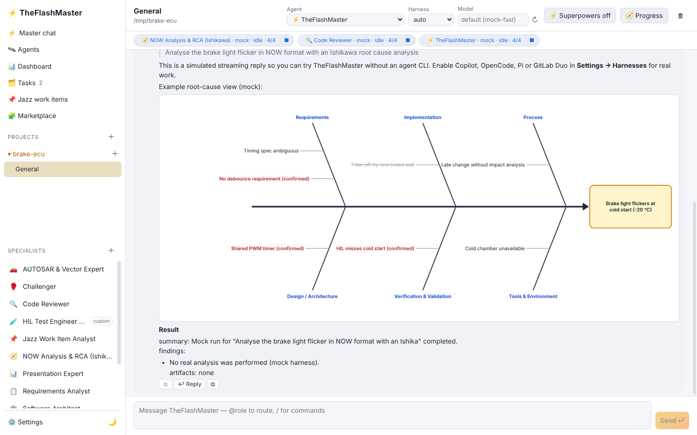

# ⚡ TheFlashMaster

**A desktop orchestrator for AI coding agents, built for enterprise automotive software teams.**

TheFlashMaster is a Windows x64 desktop app in the spirit of Codex Desktop and Claude Desktop. It runs a team of AI agents on your **local project folders**. It uses the agent CLIs **already installed and signed in on your machine**:

| Harness | How TheFlashMaster talks to it |
|---|---|
| GitHub Copilot CLI | `copilot --acp`, via the Agent Client Protocol (ACP), with streaming |
| OpenCode | `opencode acp` (ACP) |
| Pi coding agent | `pi --mode rpc` (Pi's native RPC; Pi has no MCP, so Pi agents can't use the MCP tools) |
| GitLab Duo CLI | `duo run --goal …` in headless mode, with session continuation |
| Mock | Built-in offline demo, so you can try everything without a CLI |

The app calls no model API itself and stores no model credentials. There's no login: it's a single-user local app.



| Progress flowchart | Ishikawa in chat | Import your own agent |
|---|---|---|
|  |  |  |

| Marketplace | Light mode |
|---|---|
|  |  |

## Features

- **Projects:** pick a local folder; agents work inside it. Each project has any number of **chats**.
- **Master chat** with **TheFlashMaster**, the coordinator. It plans, delegates to specialists, tracks tasks and integrates the results.
- **Streaming** replies, **threads** (reply to any message), and **reactions**. ✅/❌ reactions double as tool-approval answers.
- **Models from each harness:** the model field suggests the models each harness reports (Copilot and OpenCode via ACP, Pi via RPC; cached; ↻ refreshes). You can still type any id.
- **Clean harness instructions:** in the default *clean* mode, each CLI's own preloaded instructions (AGENTS.md, CLAUDE.md, custom rules, skills, extensions) are switched off. Copilot gets `--no-custom-instructions`; Pi gets `--no-context-files --no-skills --no-extensions --no-prompt-templates`; OpenCode gets a clean config copy plus its disable flags. GitLab Duo can only be overridden partially. Agents then follow only TheFlashMaster's agent definitions plus your **team rules** (Settings → Agents). There's an option to keep a project's AGENTS.md. Logins are untouched.
- **Agents that look alive:** working specialists pulse softly and show activity dots in the sidebar (click one to watch its progress), avatars animate while replies stream, and running agent chips glow. Animation is reduced when Windows' "reduce motion" setting is on.
- **Specialists at hand:** a sidebar palette, `@mentions` in any chat (`@autosar-vector check this ARXML`), and coordinator delegation.
  - 🥊 **Challenger**: challenges plans, designs and implementations (assumptions, pre-mortem, gaps, alternatives) and gives a verdict: proceed / proceed with changes / rethink. The coordinator asks it before executing non-trivial plans.
  - 🔍 Code Reviewer
  - 🏛️ Software Architect
  - 📋 Requirements Analyst
  - 🛠️ Software Expert
  - 🧪 Test Engineer
  - 🚗 **AUTOSAR & Vector Expert**: DBC, ARXML, CDD, DaVinci, CANoe, CAPL
  - 🐞 **winIDEA Debug Engineer**: uses the winIDEA Python SDK, `isystem.connect`
  - 📌 Jazz Work Item Analyst
  - 📊 **Presentation Expert**: creates and edits PowerPoint decks, works with corporate templates, and adds native, editable Ishikawa slides
  - 🧭 **NOW Analysis & RCA**: structured NOW analysis (Now · Objective · Way forward) with an Ishikawa root-cause analysis and 5 Whys, following INCOSE practice. The fishbone is drawn directly in the chat.
- **Bring your own agents:** start from the editable template (yourself or with your LLM), check it with live validation, and import it in the app, from `.md` files, or by dragging files onto the window. Imported agents appear in the specialist list right away; you can export or remove them.
- **🧭 Progress flowchart** for every agent: request → plan steps (done / current / pending) → specialists it delegated to → approvals → result, plus an activity timeline. Open it with the 🧭 Progress button in any chat, by clicking an agent chip, or from the Agents overview as a full page.
- **Agents overview:** every running agent, with **pause / resume / stop** and Stop all.
- **Dashboard:** token usage across agents, projects, roles, harnesses and days, plus budgets.
- **Task board** in SQLite: kanban with priorities, an assignee agent and Jazz links. **Run with agent** starts the assigned specialist with the task as its brief.
- **IBM Jazz (EWM/RTC):** query work items, analyse them with an agent, create tasks from them, and let agents update or comment through MCP tools.
- **Superpowers workflow on demand:** off by default.
  - Toggle it per chat (`/superpowers`), or load one phase: `/brainstorm`, `/plan`, `/execute`, `/tdd`, `/debug`, `/review`, `/verify`.
- **Custom tools as MCP servers.** They're auto-installed at startup when missing and attached **per session**, so your global harness configs stay untouched.
- **🧩 Marketplace for teams:** each department hosts a catalogue of plugins (custom agents, workflows, team instructions, optional tool servers) on a local server at an IP, using any static web server. Add several marketplaces in Settings → Marketplace (with an optional encrypted token). Browse by department, search, install, update and uninstall in the Marketplace page. Packages are checked against their sha256, nothing half-installs, and plugin tool servers are opt-in by policy. Teams publish with `scripts/marketplace/build-index.mjs`; see [docs/marketplace.md](docs/marketplace.md).
- **Light and dark mode:** one click with ☀/🌙 in the sidebar, or follow Windows (Settings → General → Theme).
- **Comprehensive settings,** plus an **enterprise policy file** to preset and lock them.

## Token efficiency, designed in

1. **Briefs, not transcripts.** Delegated agents get a goal, the facts they need, file paths and acceptance criteria. They never get the parent's history.
2. **Structured, capped results.** Every agent ends with a `<result>` block (summary, findings, artifacts). Only that, capped per role, goes back to the delegating agent.
3. **Artifacts.** Large outputs are stored and referenced by id (`save_artifact` / `fetch_artifact` with slices). Python tool outputs are clipped.
4. **Rolling compaction.** Older turns become a deterministic summary that costs zero tokens. Long harness sessions are rolled over to a fresh session with summary + recent turns.
5. **Stable prompt prefixes.** The role prompt and tool list are byte-identical across turns, so provider prompt caches stay warm.
6. **On-demand skills and tools.** Only the MCP servers a role declares are attached, and superpowers skills load only when asked.
7. **Query tools, not file dumps.** For example `dbc_message`, `arxml_find`, `arxml_element(depth=2)` and `cdd_services(filter)`.
8. **Budgets.** Daily, per-project and per-agent token budgets, with a warning threshold and pause/stop/warn actions.
9. **Economy routing.** Delegated specialists can run on a cheaper harness or model.
10. **Measurement.** Real usage when the harness reports it, otherwise an estimate, labelled *est.* everywhere.

## Install (users)

Download from [Releases](../../releases):

- `TheFlashMaster-<ver>-x64-portable.exe`: no installation, just run it.
- `TheFlashMaster-<ver>-x64-setup.exe`: a per-user installer that doesn't need admin rights.

Then:

1. Install and sign in to at least one harness once in a terminal, e.g. `npm i -g @github/copilot`, then run `copilot`.
2. Start TheFlashMaster. **Settings → Harnesses** shows what was detected.
3. Click **＋** next to *Projects*, pick a folder, and start chatting.
4. Optional: install **Python 3.10+** for the AUTOSAR/Vector and winIDEA tools. They install automatically on start (**Settings → MCP servers**).

See [docs/enterprise.md](docs/enterprise.md) for proxy, CA certificates, the policy file and code signing.

## Develop

```bash
npm ci
npm run dev            # Electron + Vite dev mode
npm run ci             # local CI: typecheck → lint → tests → python tests → build
npm run ci -- --smoke  # + launches the built app headlessly and checks the UI boots
npm run dist:win       # Windows x64 portable exe + installer (run on Windows)
```

If `npm run dev` reports **"Electron uninstall"**, npm skipped Electron's binary download, either because `ignore-scripts` is on or a proxy blocked it. The dev and build scripts now fetch it automatically, using your standard `https_proxy` / `http_proxy` / `no_proxy` environment variables. To use an internal mirror instead, set `$env:ELECTRON_MIRROR`.

Requirements: Node 22.13+, and Python 3.10+ with `pytest cantools python-pptx` for the Python tests.

### Release pipeline

Push a tag and GitHub Actions does the rest: it builds on `windows-latest`, runs the full CI with the smoke test, packages both executables, writes SHA-256 checksums, and publishes a GitHub Release.

```bash
git tag v0.1.0 && git push origin v0.1.0
```

## Architecture

```
Electron main (TypeScript)
├─ Db (node:sqlite, WAL)  ─ projects · chats · messages · reactions · agents · tasks · usage · artifacts
├─ HarnessRegistry ─ AcpAdapter (Copilot/OpenCode/Pi) · DuoAdapter (headless) · MockAdapter
├─ Orchestrator    ─ turns, streaming, threads, @mentions, pause/resume/stop, delegation, budgets, approvals, compaction
├─ Bridge (127.0.0.1 + token) ◄── flashmaster-core / jazz MCP servers (stdio, run with Electron-as-Node)
├─ McpBootstrap    ─ bundled Node servers + Python venv for vector-autosar / winidea
└─ JazzClient      ─ reportable REST + OSLC, form/basic auth, Electron net (system proxy + Windows cert store)
React renderer (Vite, Zustand) ── typed IPC (contextIsolation, sandbox) ── event stream for live updates
```

The full design, the decisions taken and a traceability table for every requirement are in [docs/superpowers/specs/2026-11-12-theflashmaster-design.md](docs/superpowers/specs/2026-11-12-theflashmaster-design.md).

| Path | What |
|---|---|
| `src/main/` | backend: orchestrator, harness adapters, db, bridge, MCP bootstrap, Jazz |
| `src/renderer/` | UI: chat, threads, agents, dashboard, tasks, Jazz, settings |
| `src/shared/` | types, settings schema, IPC contract |
| `agents/` | specialist role definitions (Markdown + frontmatter); `_template.md` is the template for your own agents; imported agents live in `%APPDATA%/TheFlashMaster/agents` |
| `skills/superpowers/` | on-demand workflow skills |
| `mcp-servers/` | `flashmaster-core`, `jazz` (TS), `vector-autosar`, `winidea`, `office` (Python: PowerPoint + Ishikawa) |
| `tests/` | Vitest unit and integration tests (fake ACP agent, orchestrator end to end, bridge) |

## Credits

The workflow skills are concise rewrites of [obra/superpowers](https://github.com/obra/superpowers) (MIT). Released under the MIT license.
