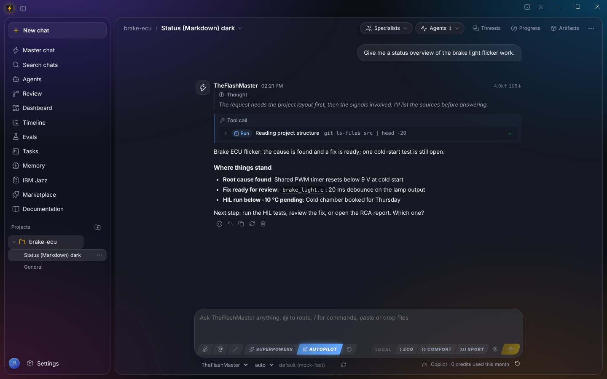
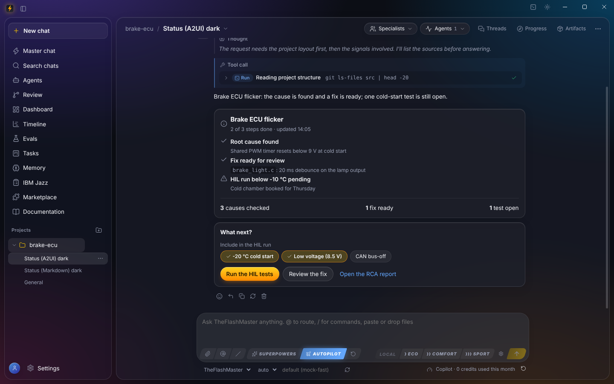

# Rich replies with A2UI

The agent you talk to (TheFlashMaster, or whichever agent runs the chat) answers with
[A2UI](https://a2ui.org) v1.0, the open Agent-to-User Interface spec (Apache-2.0,
[a2ui-project/a2ui](https://github.com/a2ui-project/a2ui)). Instead of a wall of Markdown it sends a small UI
description as data, and the chat draws it with the app's own components.

| Before (Markdown) | After (A2UI) |
| --- | --- |
|  |  |

## How a reply looks

1. One plain sentence with the outcome. Notifications, previews and plain-text views use it.
2. One fenced block with the language `a2ui` that holds A2UI messages, usually a single `createSurface` with its
   `components` (a flat list that refers to children by id, with one `root`) and its `dataModel`.

```a2ui
{"version":"1.0","createSurface":{"surfaceId":"reply-1","catalogId":"https://a2ui.org/specification/v1_0/catalogs/basic/catalog.json",
 "components":[{"id":"root","component":"Card","child":"t"},{"id":"t","component":"Text","text":"### Build is green"}]}}
```

The block may also be JSONL, a JSON array or a `json` block holding A2UI messages. While it streams in, the chat
renders every message that is already complete.

## What the chat renders

The whole basic catalog: Text (simple Markdown, file and web links work as elsewhere in the chat), Icon (drawn with
the app's Lucide icons), Image, Video and AudioPlayer (as links: the app never loads remote media by itself), Row,
Column, List, Card, Tabs, Modal, Divider, Button, TextField, CheckBox, ChoicePicker, Slider and DateTimeInput.

- **Data binding**: `{"@path": "/pointer"}` anywhere a value is allowed; paths without a leading `/` are relative to the
  item inside a list template (`"children": {"componentId": "item", "path": "/items"}`). Inputs write back to their path.
- **Functions**: formatString, formatNumber, formatCurrency, formatDate, pluralize, required, regex, length, numeric,
  email, and, or, not, openUrl. `@checks` on inputs show their message; on a button they disable it.
- **Buttons**: an `event` action sends a chat message as you: its `userMessage` (or the event name and context) as the
  line you see, then an `a2ui-action` block with the spec's `action` object (and the data model when the surface set
  `sendDataModel`). The agent reads that block on its next turn. `openUrl` opens the link through the app's usual
  link rules.
- **Look**: no colours or themes from the agent (A2UI v1.0 leaves styling to the host). Cards are glass, buttons and
  chips follow the accent colours, and everything follows the light or dark theme.

If a block isn't valid A2UI, the chat shows its source as a code block with a short note. History sent back to agents,
chat summaries and the Artifacts → Code list carry the readable text, not the JSON.

## Why a native renderer

A2UI ships reference renderers (Lit, Angular, React). The React one is built on web components with Lit, signals,
Zod and markdown-it, and brings its own look. The spec's model is that each host renders the catalog natively, so
the chat has a small renderer of its own: [`src/shared/a2ui.ts`](../src/shared/a2ui.ts) (parsing, surface state,
JSON Pointers, functions; no React) and [`src/renderer/components/A2ui.tsx`](../src/renderer/components/A2ui.tsx)
(the components). No new dependency. `tests/a2ui.test.ts` renders every official basic-catalog example
(`tests/fixtures/a2ui/`).

## Settings

Settings → Agents → **Rich replies (A2UI)**, on by default. It applies to new agent sessions of the agent you talk to.
Specialists never get the A2UI instructions: their output goes to their coordinator, not to you.

The instructions the agent gets are `A2UI_RULES` in [`src/main/context.ts`](../src/main/context.ts).
