# Flash server: private updates and marketplace

The Flash server is a small private server for TheFlashMaster that you run on your own Ubuntu machine. It does three jobs:

1. **Releases and app updates.** It stores every release and serves the update feed. People without GitHub access
   still get updates, and GitHub stays as the fallback.
2. **Marketplace.** It hosts agents, workflows, skills, scripts, tool servers (MCP), team instructions and EXAM setups.
   People browse and install them in the app.
3. **Uploads and review.** Anyone with a token can upload from the app. You approve, reject or send items back
   with feedback from the admin GUI, and the author sees the result in the app.

Everything lives in this repository but outside the app:

```
flash-server/
  API.md                 the HTTP contract shared by the server, the admin GUI and the app
  server/flashserver/    the server: Python 3.10+ standard library + SQLite, nothing to pip install
  deploy/                install.sh / update.sh / uninstall.sh, systemd unit, nginx + TLS example
  admin/                 the admin GUI you run on your own PC (PySide6 + paramiko + pyte)
  tools/publish_release.py   uploads a built release (used by scripts/release.py)
  tests/                 server tests + release publishing tests (run in CI)
```

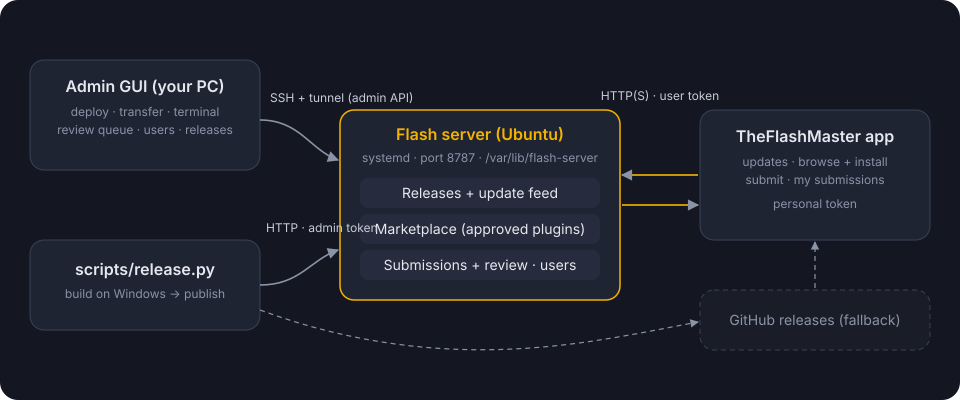

## 1. How it fits together

| Who | Talks to the server how | Uses |
|---|---|---|
| **You, in the admin GUI** | SSH to the Ubuntu machine, then HTTP through an SSH tunnel to `127.0.0.1:8787` | install/update the server, move files, the database and releases, terminal, review queue, users |
| **The app** | HTTP(S) to `http://<server>:8787` (or your nginx URL) with a personal token | update feed, marketplace, uploads, review status |
| **`scripts/release.py`** | HTTP with your admin token | uploads and publishes a new release |

The server is **private by default**. Every request needs a token, except the health check. You create a token for
each person in the admin GUI (**Users**). They paste the server URL and the token into **Settings → Flash server** in
the app. Tokens are stored only as hashes on the server. Disabling a user or rotating their token takes effect at once.

The admin API never has to be reachable from the network, because the GUI goes through the SSH tunnel. The app needs
port 8787 open on your LAN (`--open-firewall`), or nginx with TLS in front (`deploy/nginx-flash-server.conf`).

## 2. Set up the Ubuntu machine with the admin GUI

```bash
cd flash-server/admin
./run-admin.sh          # macOS / Linux: creates .venv, installs requirements, starts the GUI
run-admin.bat           # Windows
python -m flashadmin --demo   # look around with fake data, no server needed
```

**Connections:** add the machine (host, SSH port, user, key file or password). The first connect shows the host key
fingerprint and remembers it. If the key ever changes, the GUI refuses to connect, the same way `ssh` does. Passwords and
the admin token go to the system keyring (Windows Credential Manager or macOS Keychain) when one is available.

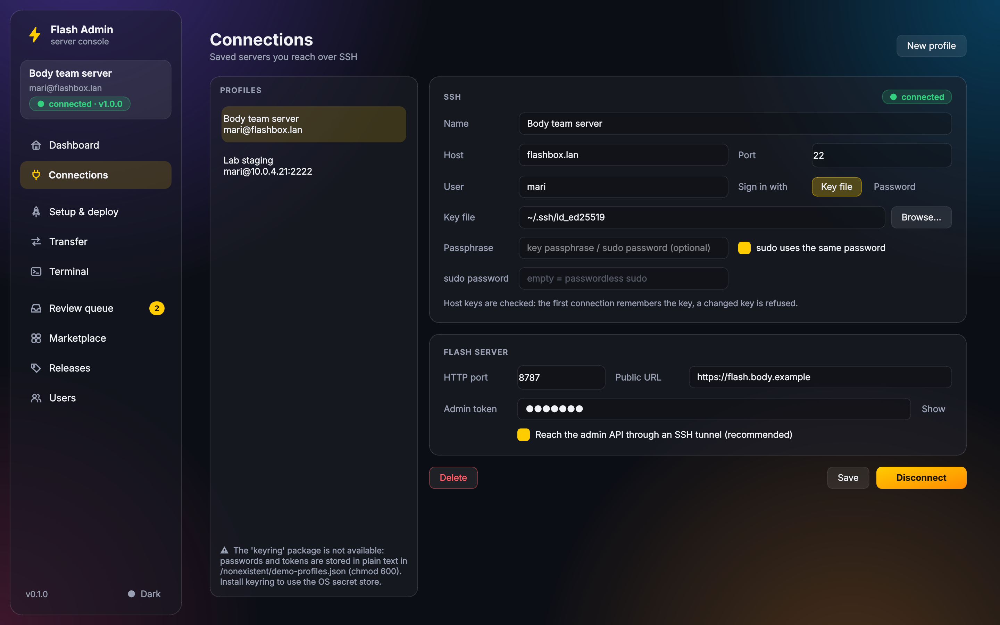

**Setup & deploy → Install / Update server:**
1. The GUI packs `flash-server/server` and `flash-server/deploy` and uploads them over SFTP.
2. It runs `sudo bash deploy/install.sh`. The script:
   - creates the `flash` system user
   - copies the code to `/opt/flash-server`
   - writes `/etc/flash-server/config.json`
   - creates `/var/lib/flash-server`
   - installs and starts `flash-server.service`
   - opens the firewall port if you ticked it
3. On the first install the script prints the **admin token** once. The GUI saves it for you.

Running it again upgrades the code and keeps all data. The same page has:
- service start / stop / restart
- live logs (`journalctl -u flash-server -f`)
- a config editor that refuses invalid JSON
- a prerequisites check (Python, systemd, disk, sudo)

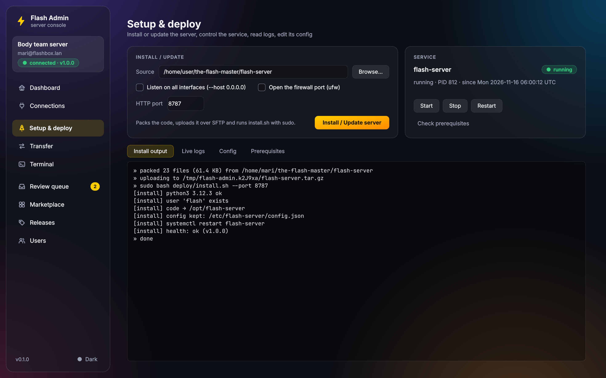

**Dashboard:** users, published plugins, pending reviews, the current stable and beta versions, free disk space and uptime.

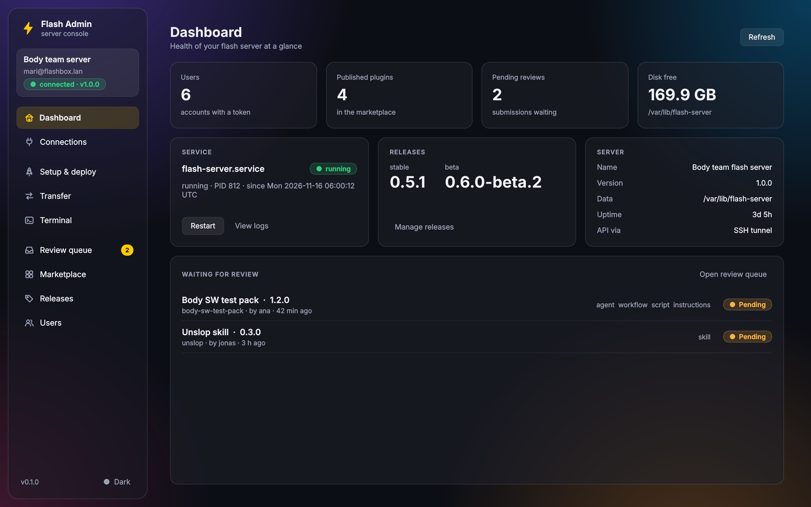

What's on the machine afterwards:

```
/opt/flash-server/            code (replaced on every deploy)
/etc/flash-server/config.json { "name", "host", "port": 8787, "dataDir", "publicRead": false }
/var/lib/flash-server/        flash.db (SQLite), releases/, marketplace/, submissions/, backups/
```

## 3. Move files, the database and releases to the machine

**Transfer** has a two-pane file browser (your PC on one side, the server on the other) with progress bars, plus four
one-click jobs:

| Button | What it does |
|---|---|
| **Upload release folder** | Pick `release/`. Every file of that version is uploaded with a SHA-256 check, then published on stable or beta |
| **Import marketplace folder** | Pick a marketplace folder (`plugins-src/` + `files/`, e.g. `marketplace-example`). Every plugin is published as approved |
| **Backup database & data** | Runs `flashserver backup` on the server and downloads the `.tar.gz` (database, releases, marketplace, submissions) |
| **Restore** | Uploads a backup, stops the service, restores it and starts the service again (asks first) |

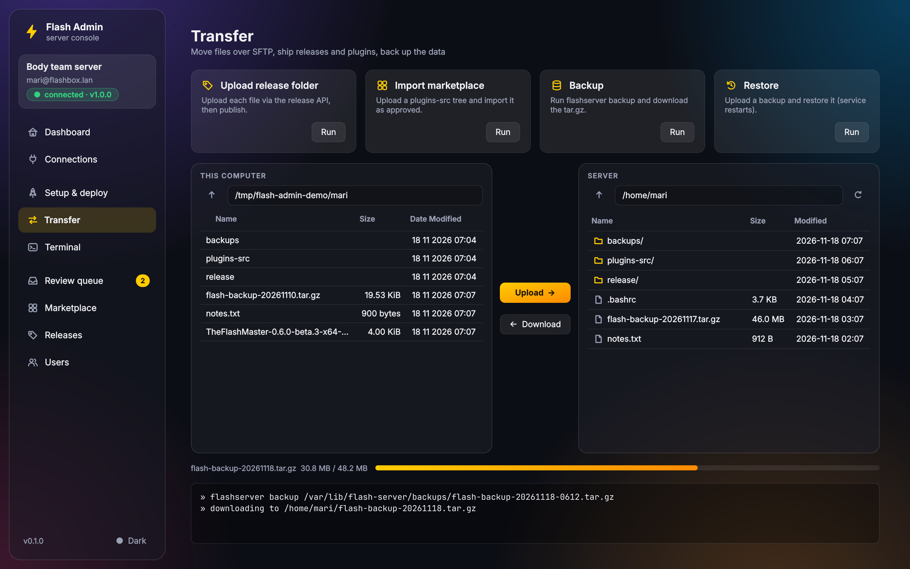

**Terminal** is a real SSH shell with colours, a cursor, resize, copy/paste and several tabs. Use it for anything the
buttons don't cover.

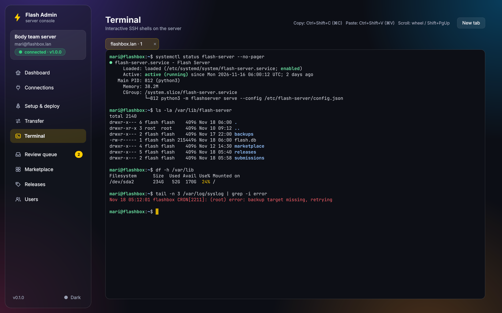

## 4. How app updates work

```
scripts/release.py ──PUT files + publish──▶ Flash server ──/updates/stable/latest.json──▶ app
                    └─(optional) GitHub release────────────────────────────────────────────▶ app (fallback)
```

**Publishing a release.** The usual way is the release script on your Windows machine:

```powershell
$env:FLASH_SERVER_URL = "http://flashbox.lan:8787"
$env:FLASH_SERVER_TOKEN = "fs_…"            # the admin token (admin GUI → Connections)
py -3 scripts/release.py                    # GitHub + Flash server
py -3 scripts/release.py --target server    # Flash server only (no GitHub needed at all)
```

The script builds as before. Then it uploads the installer, the portable exe, `latest.json` and `SHA256SUMS.txt`, and
publishes them on **stable**, or on **beta** for versions like `1.4.0-beta.1`. A failed upload can be resumed with
`--skip-build --version X --target server`. You can also upload a `release/` folder from the GUI (**Transfer**), or use
`flash-server/tools/publish_release.py` on its own.

**Releases page:** see every release and which one each channel points at. You can promote a beta to stable, roll stable
back to an older version, or delete a release no channel uses.

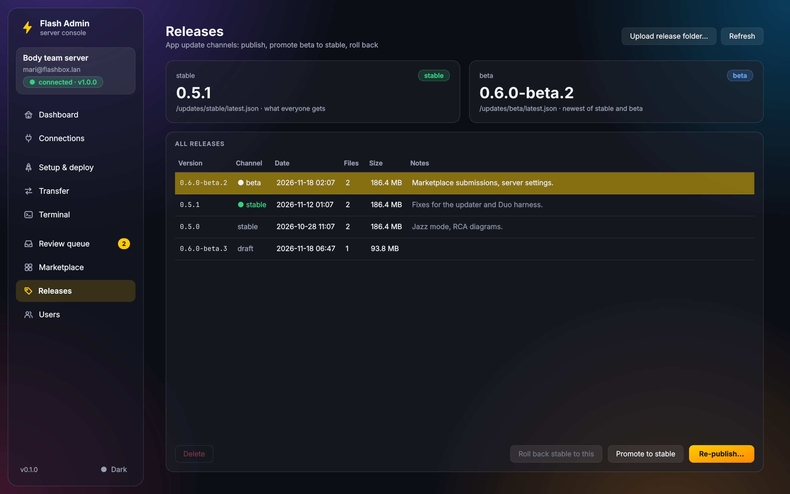

**In the app.** When a server is set (in Settings → Flash server, or built in through `package.json →
flashmaster.server.url`):
1. The app checks `<server>/updates/<channel>/latest.json` with the person's token.
2. It downloads the installer or portable exe and verifies its SHA-256. A file that doesn't match is thrown away.
3. If the server can't be reached or answers with an error, the app falls back to the repository feed
   (`flashmaster.updates.url`, i.e. GitHub) when one is configured.

The server token is only ever sent to the server, and the GitHub token only to GitHub. **About** shows where the
update came from:

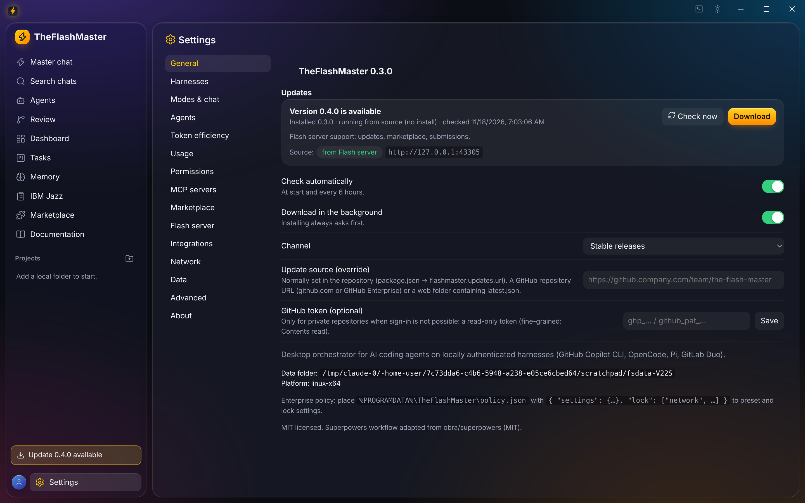

The server serves exactly the format the app already understood (`latest.json` next to the files). An older build
updates from it just by setting the server URL as its update source.

## 5. How the marketplace works

Everything is a **plugin**: a versioned package that can hold any mix of these:

| Kind | In the package | Becomes in the app |
|---|---|---|
| Agents | `agents/*.md` | specialists (sidebar, `@mention`, delegation) |
| Workflows | `workflows/*.md` | slash commands |
| Skills | `skills/*.md` | slash commands loaded on demand |
| Scripts | `scripts/*.{py,ps1,sh,js,bat,…}` | files in `<data>/plugins/<id>/scripts/`. Agents are told where they are |
| Tools (MCP) | `mcp.json` | tool servers, added disabled unless policy allows them |
| Instructions | `instructions.md` | team rules for every agent (can be switched off per plugin) |
| EXAM setup | `exam.json` | fills in Settings → EXAM and installs the RESTapi plugin |

A single agent or script is just a plugin with one file, so everything installs, updates and uninstalls the same way.

The app lists the server as the marketplace source **Flash server**. People filter by kind, search, install, and get
**Update all** when a newer version is approved.

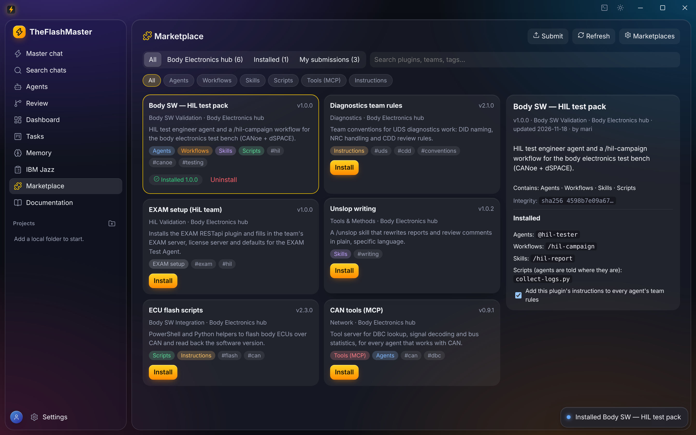

### Uploading from the app

**Marketplace → Submit**: pick a folder in the `plugins-src/<id>/` layout (with `plugin.json`), or a few single files
(agent, workflow, skill or script; the kind is guessed and can be changed). Fill in id, name, version and a note for
the reviewer. **Check** runs exactly the validation the install uses, so problems show up before anything is sent.
**Submit** sends the package to the review queue.

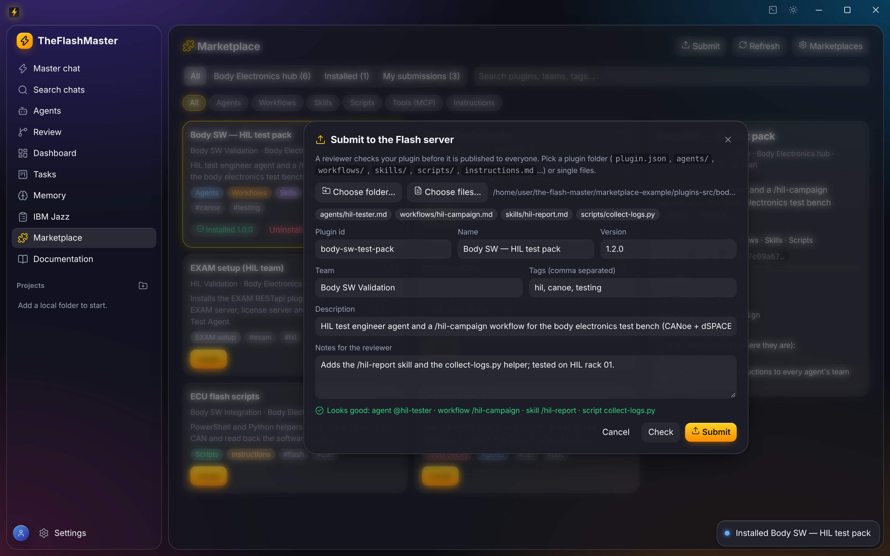

Rules the server enforces:
- The first approved author **owns** a plugin id. Nobody else can submit that id, but admins can.
- A version can't be published twice: raise the version.
- Size limits apply (2 MB per package, 200 KB per script).
- Submitting the same version again while it's pending, or after "changes requested", replaces the earlier upload.

### Reviewing in the admin GUI

**Review queue** shows pending submissions first, with a count in the sidebar. For each one you see:
- author, notes and kinds
- every file in the package
- a **diff against the previous published version**

Then choose **Approve & publish**, **Request changes** or **Reject**. Feedback is required for the last two.
Approving publishes the plugin right away.

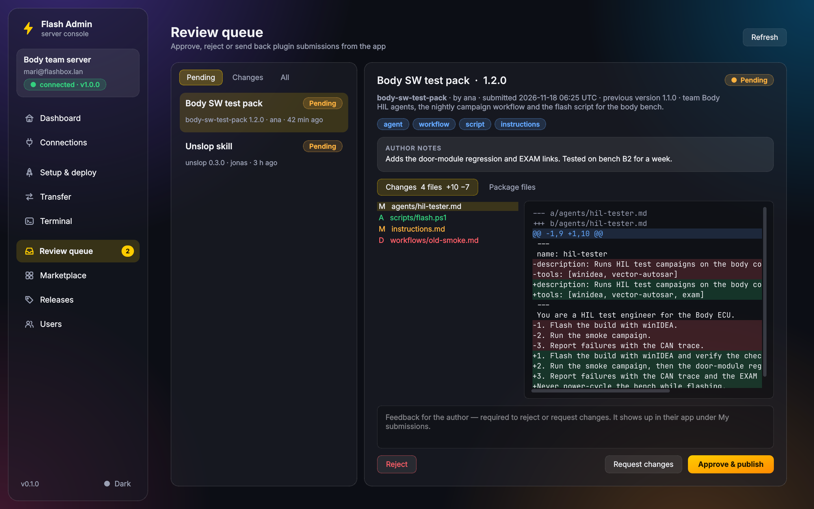

### What the author sees

**Marketplace → My submissions** shows each upload with its status (pending, approved, changes requested, rejected,
withdrawn), your feedback, and when it was reviewed. There's **Resubmit** for "changes requested" and **Withdraw** while
it's pending. When a status changes, the app shows a notice, even if the Marketplace page isn't open. The app checks
every 15 minutes and on Refresh.

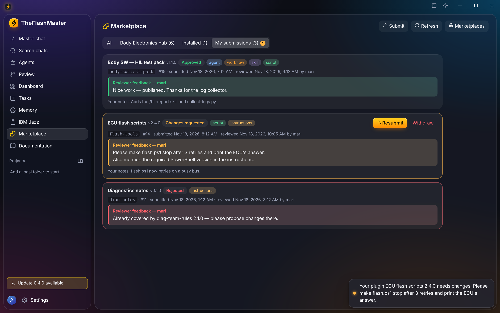

**Marketplace** in the admin GUI lists what's published. You can unpublish one version or the whole plugin.

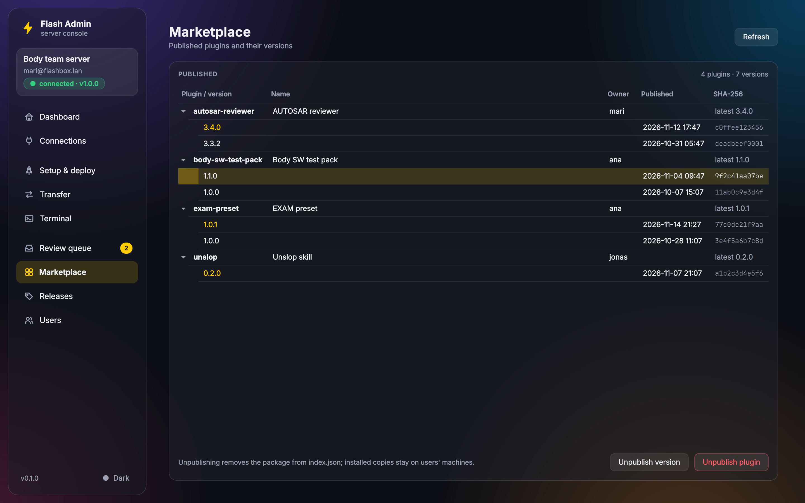

## 6. Users and tokens

**Users → New user** creates the account and shows the token **once**, with a ready-to-send note (server URL and
token). From the same page you can also:
- rotate a token
- disable a user
- make someone an admin
- delete a user

The last active admin can't be removed.

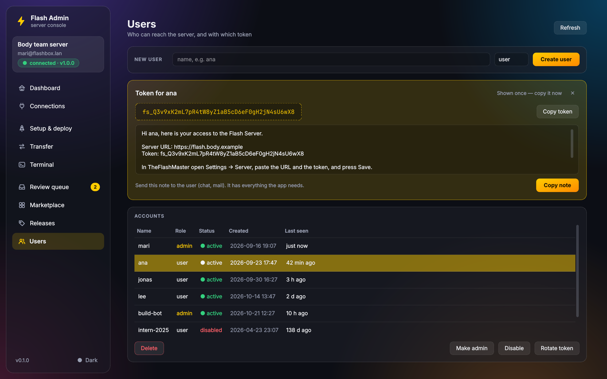

In the app, each person opens **Settings → Flash server**, pastes the URL and token, and clicks **Test connection**.

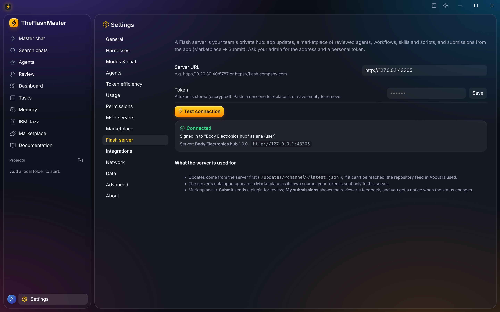

## 7. Operating it

| Task | How |
|---|---|
| Upgrade the server | GUI: Install / Update server (or `sudo /opt/flash-server/deploy/update.sh`, which backs up first) |
| Logs | GUI: Setup & deploy → Logs, or `journalctl -u flash-server -f` |
| Backup / restore | GUI: Transfer, or `sudo -u flash python3 -m flashserver backup /var/lib/flash-server/backups/x.tar.gz --config /etc/flash-server/config.json` |
| HTTPS | put nginx in front: `deploy/nginx-flash-server.conf` (TLS, 2 GB uploads), keep the server on `127.0.0.1` |
| Allow reading without a token | set `"publicRead": true` in the config (uploads still need a token) |
| Remove | `sudo /opt/flash-server/deploy/uninstall.sh` (keeps the data unless you pass `--purge`) |

See [flash-server/README.md](../flash-server/README.md) for the full CLI, and [flash-server/API.md](../flash-server/API.md)
for every route.

## 8. How it was tested

- Server: `flash-server/tests`, run in CI on Windows, macOS and Linux. It covers the whole HTTP flow, auth, ownership,
  path traversal, releases, backup/restore, importing `marketplace-example` and publishing from the release script.
- App against the **real** server: `tests/flash-server.e2e.test.ts` starts the Python server. The app's own code then
  submits a plugin, gets "changes requested" with feedback, resubmits, gets approved, installs from the private marketplace
  with the token, and updates from the private feed with checksum verification.
- Admin GUI: `flash-server/admin/tests` (API client, SSH round trip, terminal, packaging, offscreen window smoke test).
- A real deploy: the GUI's own deploy code ran against an Ubuntu 24.04 machine with systemd and SSH. It covered:
  - install (admin token captured)
  - the service running and the tunnel working
  - importing `marketplace-example`, including the EXAM attachment
  - uploading and publishing a release
  - creating a user and taking a backup
  - a second install keeping all data
  - a terminal session

  The app could then read the feed and the index with a user's token, and was refused without one.
