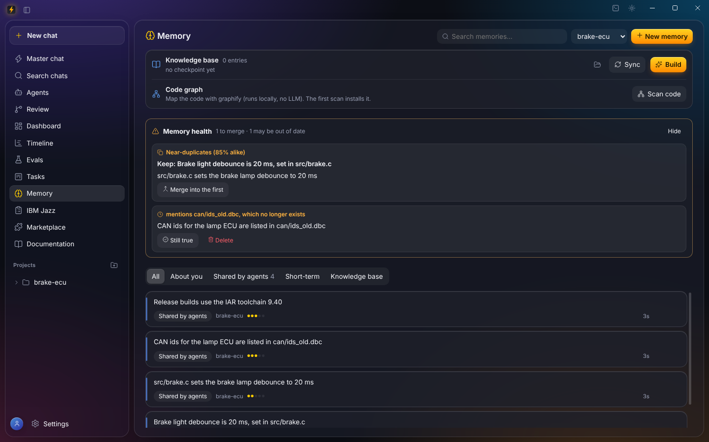

# Memory hygiene, local embeddings and Agent Skills

## Memory health

Memories pile up and go out of date. The Memory page shows a **Memory health** panel for the selected project:



- **Near-duplicates**: memories in the same place that say nearly the same thing. **Merge into the first** keeps the most
  important one (pinned, then importance, use, age) with every tag, the highest importance and the combined use count.
  Exact and very close copies (90%+ alike) are already merged when an agent saves them.
- **May be out of date**: a project memory that mentions a file that no longer exists, or a file that changed since the
  memory was saved. Project memories now record the commit (git HEAD) they were saved at, so the app can check what
  changed since. **Still true** stamps the memory with the current commit; **Delete** removes it.
- **Unused**: low importance (1–2), not pinned, and neither used nor changed for 90 days.

Nothing changes until you click. Memories about you (user scope) are never flagged as out of date.

## Local embeddings (optional)

Memory search combines keyword (FTS) and fuzzy matching, and can also rank by meaning with an embedding model running on
your own computer:

1. Install [Ollama](https://ollama.com) and pull a model: `ollama pull nomic-embed-text`.
2. Go to Settings → Memory → **Local embeddings** and pick *Ollama (local)*. Change the address or model if yours differ.

Existing memories are embedded in the background, and new ones as they are saved. Search then also finds memories that
share no words with the query ("automobile" finds "car"). If Ollama is slow or not running, search works as before.
Nothing leaves your computer.

## Agent Skills (SKILL.md)

TheFlashMaster reads skills in the open Agent Skills format: a folder with a `SKILL.md` that starts with front matter
giving its `name` and `description`, plus any scripts, references or templates it needs.

```
.claude/skills/misra-check/
  SKILL.md          ---\nname: misra-check\ndescription: Check C code against MISRA C:2012 rules\n---\n…instructions…
  scripts/check.py
  rules.md
```

It looks for skills in these places (a project's skill wins on a name clash):

- in the project: `.flashmaster/skills/`, `.claude/skills/`, `.agents/skills/`
- for you: the app's skills folder, `~/.claude/skills/`, `~/.agents/skills/`

Agents see only each skill's name and description when a session starts. When a skill fits the task, the agent loads it
with the `use_skill` tool, which returns the full instructions, the skill's folder and the files it ships. Skills also
work as slash commands (`/misra-check …`), and a role can list them under `skills:` to load them up front.
