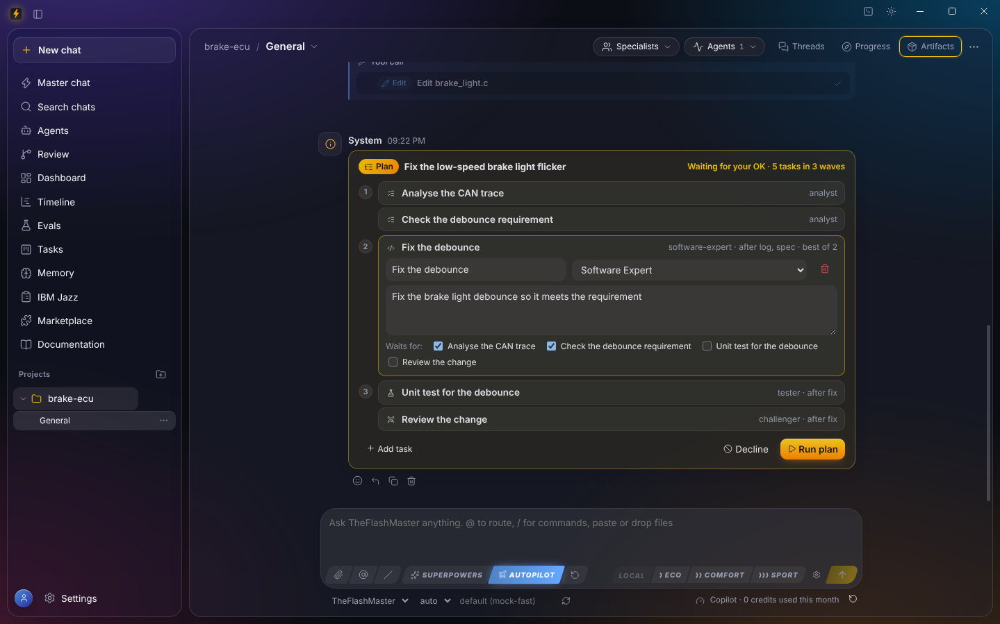
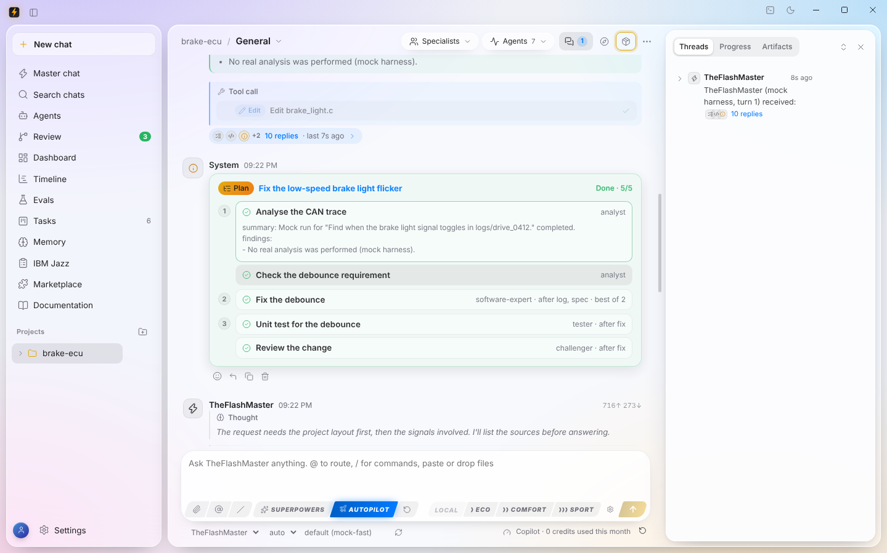

# Task plans, working state and summaries

## Task plans

For work with three or more specialist steps that depend on each other, the coordinator proposes the whole task graph
with `propose_plan` instead of delegating one step at a time. Each task has a role, a brief (`goal`), the tasks it waits
for (`dependsOn`), and optionally a `mode` (eco / comfort / sport) and `attempts` (best of N).

The plan shows up in the chat as a card, grouped into the waves it will run in. While it waits for you, you can:

- open any task to change its title, role, brief or what it waits for;
- remove tasks, or add one;
- **Run plan** (or **Save and run** after an edit), or **Decline**. When you decline, the coordinator hears about it and
  asks what you want instead.

Code runs the plan, not the model:

- every task whose dependencies are done starts at once (the team limit in Settings → Agents still applies);
- each task gets its dependencies' results in its brief;
- a task that fails, is blocked or needs a decision skips everything that depends on it;
- the coordinator gets **one** message with every task's result when the plan has finished, instead of being woken
  once per specialist.

Settings → Agents → **Task plans** chooses whether you approve each plan (the default) or plans run right away. The
app checks a plan before it runs: at most 20 tasks, known roles, no unknown dependencies and no cycles.

## Working state

Every agent keeps a small working state: its goal, what it has done, its decisions, its next steps, the files it touched
and its open questions. Specialists keep it current with the `update_state` tool. The app records the goal of each
delegation and every file the agent edits.

When an agent gets a fresh session, its first prompt includes that state, so it picks up where it left off instead of
starting again from the brief. A fresh session happens when a long session is rolled over to save context, after a
crash, after an idle close, or when a follow-up asks for another model. Before this, a specialist's new session saw only
its original brief.

## Summaries

Older chat turns are summarised once the chat passes Settings → Token efficiency → **Compact after (tokens)**. Two
writers are available:

- **The app (extractive, free)**, the default. It keeps each turn's result summary or first sentences, and costs no
  tokens.
- **A cheap or local model**. Set **Summary model** as `harness/model`, for example `pi/qwen-local/qwen3-coder`.

The model summary runs in the background with no tools. The extractive summary is used straight away, and the model's
summary replaces it when it arrives. If the model fails or times out, the extractive one stays.
