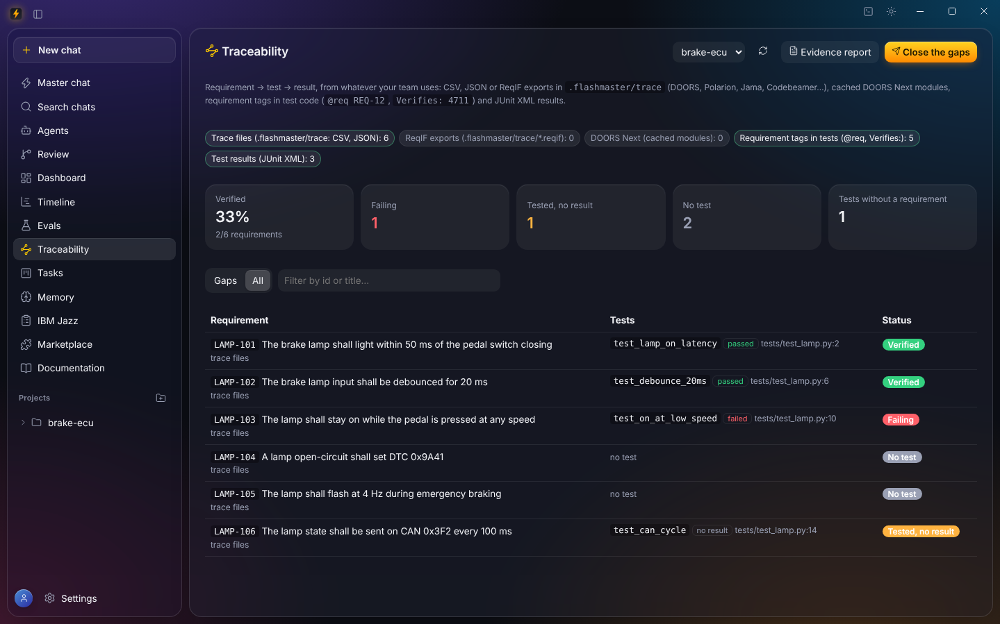
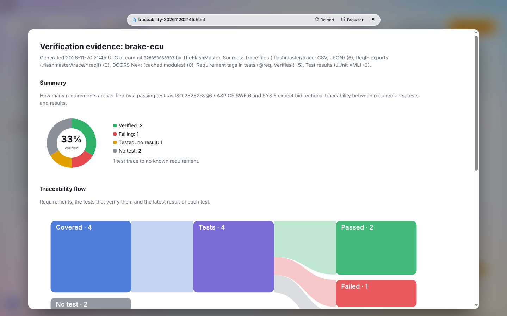
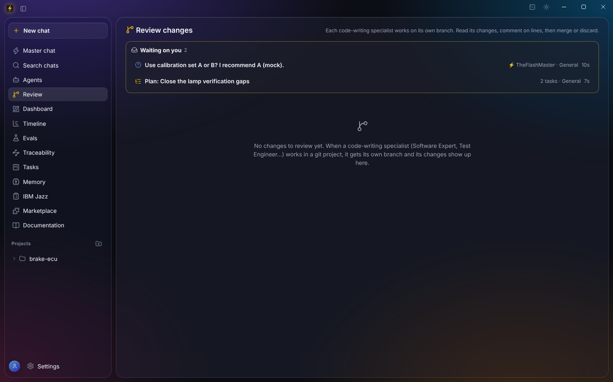

# Traceability and the review inbox

## Traceability

The **Traceability** page shows, for one project, every requirement, the tests that verify it and the latest result of
each test. It does not depend on one tool: it reads whatever the project has.



| Source | Where | What it gives |
| --- | --- | --- |
| Trace files | `.flashmaster/trace/*.csv`, `*.json` | Requirements (`id`, `title`). A row with a `verifies` column is a test linked to those ids. |
| ReqIF exports | `.flashmaster/trace/*.reqif` | Requirements exported from DOORS, Polarion, Jama, Codebeamer or PTC. |
| DOORS Next | modules loaded before on the IBM Jazz page | Requirements, from the cache only (no network call). |
| Tags in test code | test files (`tests/`, `test_*.py`, `*.test.ts`, `*_test.go`, CAPL test cases…) | Tests: `@req REQ-12`, `Verifies: 4711`, `Covers:`, `Satisfies:` above or inside a test. |
| Test results | JUnit XML in `test-results/`, `reports/`, `build/test-results/`, `build/reports/`, `TestReports/` | The latest outcome of each test, matched by name. |

Each requirement gets a status: **Verified** (every linked test passed), **Failing** (a linked test failed),
**Tested, no result** (linked tests have no result yet) or **No test**. Tests that name an unknown requirement are listed
separately. Settings → Data changes the traceability tag pattern (a regular expression whose first group holds the ids) and
the result folders.

A minimal trace file:

```csv
ID,Title
LAMP-101,The brake lamp shall light within 50 ms of the pedal switch closing
LAMP-102,The brake lamp input shall be debounced for 20 ms
```

and a tagged test:

```python
# @req LAMP-101
def test_lamp_on_latency():
    ...
```

**Evidence report** writes `reports/traceability-<time>.html` in the project and opens it in the viewer: a coverage
donut, the requirement → test → result flow, the gaps and the full matrix, stamped with the commit. It is the kind of
evidence ISO 26262-8 §6 and ASPICE SWE.6 / SYS.5 ask for.



**Close the gaps** sends the gaps to the project's coordinator, which proposes a plan to write the missing tests (tagged
with the requirement ids) and fix what fails. Agents can read the same matrix at any time with the `trace_matrix` tool.

## Review inbox

The top of the **Review** page lists everything that waits on you, across all chats: questions and blockers from agents,
task plans to approve, specialists' branches whose checks fail, and branches ready to review and merge. Click an item to
go to its chat or branch.


