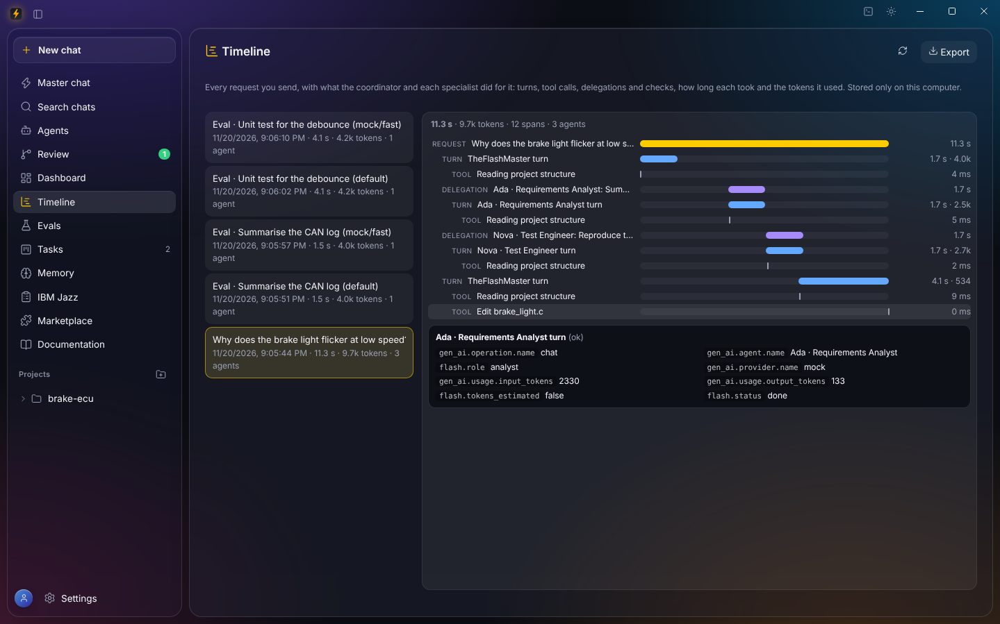
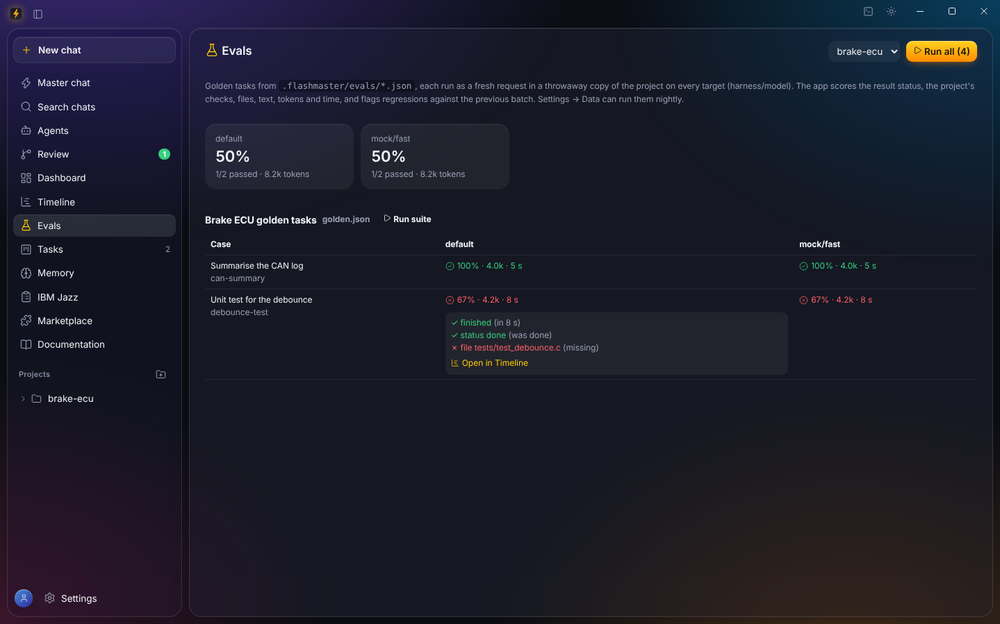

# Traces, Timeline and evals

You can see where time and tokens went for each request, and you can check that a change of model, prompt, role or
harness didn't make the agents worse.

## Traces and the Timeline

Every request you send to a coordinator gets recorded as a trace. A trace is a tree of spans:

| Span | What it covers |
|---|---|
| Request | your message, from send until the last agent working on it is idle |
| Turn | one turn of one agent, with its harness, model and input/output tokens |
| Tool | one tool call inside a turn (file read, edit, shell command, MCP tool) |
| Delegation | a specialist's task, from `delegate` until its result goes back |
| Checks | a run of the project's checks in a specialist's worktree |

The sidebar's **Timeline** lists the requests. Open one to see a waterfall of everything the coordinator and its
specialists did for it, with durations and tokens. Hover a row to see its attributes. Span attributes use the
OpenTelemetry GenAI names (`gen_ai.operation.name`, `gen_ai.provider.name`, `gen_ai.request.model`,
`gen_ai.usage.input_tokens`, …), plus `flash.role`, `flash.agent.id` and others.



**Export** downloads the trace as OTLP/JSON, which Jaeger, Grafana Tempo, Arize Phoenix or any other OpenTelemetry
viewer can open. Traces stay on this computer, in the app's database. Settings → Data turns them off and sets how many
days they are kept (30 by default). Spans that were still open when the app quit are closed as "stopped" at the next
start.

## Evals

An eval suite is a JSON file in the project's `.flashmaster/evals/` folder. Commit it with the code so everyone runs the
same golden tasks.

```json
{
  "name": "Brake ECU golden tasks",
  "targets": ["", "copilot/claude-sonnet-5.5", "pi/qwen-local/qwen3-coder"],
  "cases": [
    {
      "id": "debounce-test",
      "title": "Unit test for the debounce",
      "prompt": "Add a unit test for the brake light debounce in src/brake.c",
      "timeoutMinutes": 20,
      "expect": {
        "status": "done",
        "checks": true,
        "files": ["tests/test_brake.c"],
        "contains": ["debounce"],
        "regex": "\\d+\\s*ms",
        "maxTokens": 400000,
        "maxMinutes": 15
      }
    }
  ]
}
```

- `targets` lists `harness/model` pairs. `""` means your usual harness and model. Without `targets` a suite runs on the
  default only.
- Each case runs as a fresh request to a coordinator in a throwaway copy of the project (a worktree at
  `.wt/eval-<id>` on its own branch). The specialists' work is merged into that copy, then the project's checks run
  there. The copy, its branch and the temporary chat are removed afterwards. Your project is never touched.
- `expect` is scored one assertion at a time: the case finished before `timeoutMinutes` (30 by default), the
  coordinator's result `status`, the project's `checks` pass, each of `files` changed, the reply contains each of
  `contains` (ignoring case) and matches `regex`, the request stayed under `maxTokens` and `maxMinutes`. The score is
  the share of assertions that passed. A case passes only when all of them pass.

The sidebar's **Evals** page shows each suite as a table of cases × targets for the latest batch, with score, tokens and
time, a pass rate per target, and a strip of the last batches. Click a cell for the assertions and **Open in Timeline**
for the full trace of that run.



A cell is flagged as a **regression** when the case passed in the previous batch and fails now, or when it used at least
50% more tokens (and over 5,000 more).

Run all suites, one suite, or turn on Settings → Data → **Run evals nightly** to run them at a set hour, optionally on a
different list of targets. Evals spend real tokens on every target, so keep suites small and focused.
